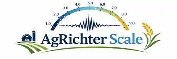

<p align="center"></p>

# AgRichter Project (2025)

## Overview

The AgRichter project introduces a new scale for quantifying global agricultural production disruptions, analogous to the Richter scale for earthquakes. This repository contains the Python codebase for calculating AgRichter magnitudes, generating H-P (Harvest-Production) envelopes, and producing the figures for the associated publication.

The core analysis relies on:
-   **SPAM 2020 (V2r0)** global agricultural data (Production and Harvest Area).
-   **Historical Event Data** (e.g., Dust Bowl, Great Famine) mapped to grid cells.
-   **H-P Envelope Framework** to define upper and lower bounds of production loss for a given disrupted area.

## Interpreting Potential and Historical Losses

The H–P envelopes are **end-member potential-loss scenarios**, not estimates that all production was actually destroyed during historical events. The historical-event overlays use SPAM 2020 agricultural exposure in designated affected regions and should not be interpreted as observed historical losses without event-specific evidence. We are assembling a separate, source-traceable record of historical harvest and production outcomes—including incomplete and noncomparable records—to assess the plausibility of these scenarios without conflating exposure with realized losses.

See [historical-event audit](docs/HISTORICAL_EVENT_AUDIT.md), [historical-loss comparison protocol](docs/HISTORICAL_LOSSES_METHOD.md), and [initial evidence inventory](ancillary/historical_loss_evidence_seed.csv).

## Systematic historical loss inventory

The event registry now preserves **all 23 legacy cases** and separately identifies **four additional screening candidates**: the Soviet famine of 1932–33, the war in Ukraine (from 2022), the Sudan conflict (from 2023), and conflict-related disruptions in South Sudan. The first evidence records for the modern cases come from FAO and FAO/WFP crop assessments. A registered event is **not** evidence of an observed crop-production shortfall, and none of the new records is yet a harmonized quantitative comparison with an H–P envelope.

To avoid cherry-picking, selection does not depend on whether the reported crop change is large, negative, or even quantifiable; the protocol requires documenting positive changes, missing data, causal ambiguity, and overlapping events. The current additions are illustrative candidates, **not a completed global conflict census**. See the [selection protocol](docs/HISTORICAL_EVENT_SELECTION_PROTOCOL.md), [27-case registry](ancillary/historical_event_registry.csv), [historical evidence inventory](ancillary/historical_loss_evidence_seed.csv), and [registry validation script](scripts/validate_historical_registry.py).

### Systematic production screening (in development)

The [v1.0 selection protocol](docs/HISTORICAL_EVENT_SELECTION_PROTOCOL.md) separates the complete 1961-onward production observation frame, documentary event screening and archival reconstructions. The [FAOSTAT screening pipeline](docs/FAOSTAT_SCREENING.md) implements prospective trend-based anomaly flags and preserves missing, zero and positive outcomes. A local QCL snapshot has been audited and screened through 2024 ([findings](docs/FAOSTAT_SNAPSHOT_FINDINGS.md)). Territorial code successions are recorded in the [boundary audit](docs/FAOSTAT_BOUNDARY_AUDIT.md). An [official-only rerun](docs/FAOSTAT_OFFICIAL_ONLY.md) keeps flag A and sets aside estimated, imputed, and external values. The [screen review](docs/FAOSTAT_SCREEN_REVIEW.md) compares trend and median baselines and separates small denominators. A [documentary search log](docs/DOCUMENTARY_SEARCH_LOG.md) records a disposition for all 27 registry cases. [Observation links](docs/FAOSTAT_OBSERVATION_LINKS.md) name the reporting area in force, or an explicit no-row. The [archival reconstruction](docs/ARCHIVAL_RECONSTRUCTION.md) records pre-1961 figures separately from that panel. A [FamineWatch crosswalk](docs/FAMINEWATCH_CROSSWALK.md) checks the famine chronology against the same 27 cases. The [footprint inventory](docs/EVENT_FOOTPRINT_AUDIT.md) lists the workbook places behind the current event points. The parser now keeps every workbook country and binds each subdivision to the GDAM code on its state-sheet row. Figures 1–4 were not redrawn. A [source check](docs/SOURCE_CHECK.md) re-reads the unverified crop sentences and does not treat them as event losses. The [figure redraw gate](docs/FIGURE_REDRAW_GATE.md) lists the six conditions that had to hold before Figures 1–4 were redrawn. The [redraw note](docs/FIGURE_REDRAW_2026-11.md) gives the caption and the points that moved; the old images are kept with a `_pre_fix` suffix. [Event classification](docs/EVENT_CLASSIFICATION.md) records citation status, footprint uncertainty flags, the rule that separates crop-disruption evidence from famine and conflict, and the ENSO 2015–16 overlap. A [primary source pass](docs/PRIMARY_SOURCE_PASS.md) opened FAO, USDA, and journal pages for 11 of the 12 events that had no opened source; none is adopted as an event loss. [Softened claims](docs/SOFTENED_CLAIMS.md) lists the compilation percents and crop-failure statements that are not stated as fact, with wording for the paper. The [quantity label](docs/EVENT_QUANTITY_LABEL.md) names the plotted event numbers as 2020 exposure under a complete-disruption counterfactual. The 27-event registry is not a representative sample, and the production panel must not be treated as a catalog of independent events.

## Repository Architecture

The repository is structured into two main components:

1.  **`agrichter/` (Core Library)**: This is the engine room of the project. It is structured as a modular Python package containing the reusable scientific logic, data loaders, and mathematical algorithms (e.g., H-P envelope calculation, magnitude mapping). Core scripts should **not** be modified for one-off figure adjustments; they provide the "source of truth" for the analysis.
    -   `core/`: Unified configuration, caloric constants, and unit conversions.
    -   `data/`: Robust loaders for SPAM 2020 gridded data and USDA FAS PSD time-series.
    -   `analysis/`: The mathematical core, including the `HPEnvelopeCalculator` and `EventCalculator`.
    -   `visualization/`: Base plotting modules that ensure consistent styling and dimensional analysis across all outputs.

2.  **`scripts/` (Output Generation)**: These are standalone execution scripts that "call" the `agrichter` library to generate specific publication assets. They handle the "layout" logic (e.g., multi-panel subplots, specific country selections) for the journal.

## Repository Structure

-   **`agrichter/`**: The main Python package containing the core logic (see Architecture above).
-   **`scripts/`**: Main entry point for figure generation. Contains scripts to generate publication figures.
-   **`results/`**: Output directory for generated figures and tables.
    -   Main figures (e.g., `figure1_agrichter_scale.png`) are located in the root of this folder.
    -   Individual component plots (e.g., single-crop or single-country versions) are saved in the `results/individual_plots/` subfolder.
-   **`USDAdata/`**: Refreshed USDA PSD data (Jan 2026 update).
-   **`ancillary/`**: Helper data files (country codes, event definitions, etc.).
-   **`archive/`**: Obsolete data, legacy scripts, and old outputs (ignored by Git to keep the repo clean).

## Figure Generation

The publication figures are generated using the scripts in the `scripts/` directory. These scripts import the `agrichter` library to process data and generate consistent, high-quality outputs.

### Prerequisites

Ensure you have the required dependencies installed:
```bash
pip install -r requirements.txt
```

### Running the Scripts

Run the following commands from the root of the repository to generate the figures. The output files (PNG and SVG) will be saved to the `results/` directory.

**Figure 1: AgRichter Scale**
Shows the relationship between AgRichter Magnitude ($M_D$) and harvest area for historical events.
```bash
python3 scripts/fig1_agrichter_scale.py
```

**Figure 2: H-P Envelopes (The Innovation)**
Shows the Harvest-Production envelopes and historical events for wheat, maize, rice, and all grains.
```bash
python3 scripts/fig2_hp_envelopes.py
```

**Figure 3: Country H-P Envelopes**
Shows H-P envelopes and scaled thresholds for specific countries (USA, China, India, Brazil, etc.).
```bash
python3 scripts/fig3_country_envelopes.py
```

**Figure 4: Risk Probability Curve**
Calculates the annual exceedance probability of agricultural disruptions based on the historical record.
```bash
python3 scripts/fig4_risk_probability.py
```

**Figure S1: Global Maps (Supplementary)**
Generates global production and harvest area maps for all crops.
```bash
python3 scripts/figS1_global_maps.py
```

**Figure S2: Comparative Vulnerability**
Generates comparative plots of normalized envelopes for multiple countries.
```bash
python3 scripts/figS2_comparative.py
```

**Figure S3: Resilience Typologies**
Compares "stiff" vs "wide" envelopes to highlight national agricultural resilience.
```bash
python3 scripts/figS3_envelope_bounds.py
```

## Documentation

Detailed documentation for the codebase and methodologies can be found in `archive/docs/` if needed for reference, although the current codebase in `agrichter/` is the source of truth.

## License

[Insert License Information Here]


